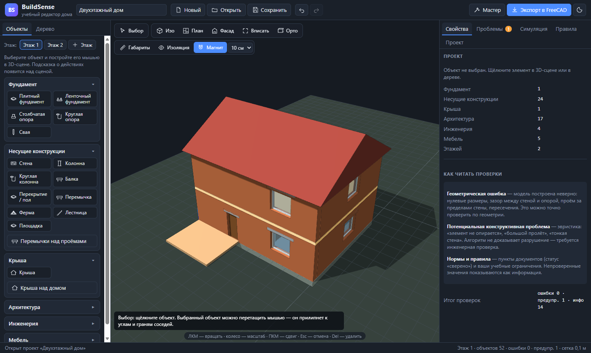
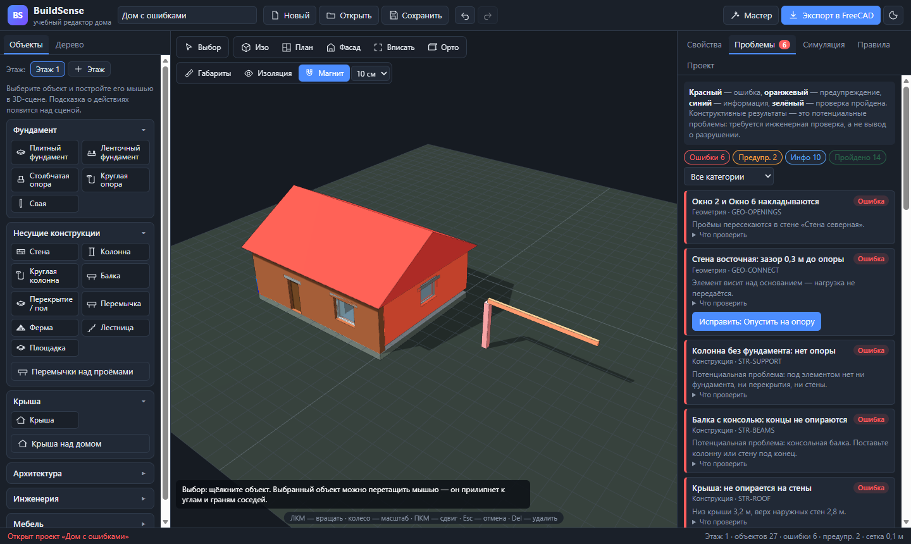

# BuildSense — учебный визуальный редактор дома

BuildSense позволяет без опыта проектирования собрать трёхмерную модель дома из строительных элементов,
менять их, видеть геометрические ошибки и потенциальные конструктивные проблемы, запускать наглядную
демонстрационную симуляцию разрушения и выгружать модель во FreeCAD.

Это **учебный прототип**: не замена CAD/BIM-системам и не инженерный расчёт. Проверки конструкции — эвристики
(«потенциальная проблема», «требуется инженерная проверка»), симуляция — демонстрация заданного сценария,
нормы — только сверенные пункты документов, остальное явно помечено.

| Редактор | Проверки | Импорт во FreeCAD 1.1.4 |
|---|---|---|
|  |  |  |

## Запуск

Ничего устанавливать не нужно: ни сервера, ни Python, ни интернета.

- **Windows** — двойной щелчок по `index.html` (или `start.bat`).
- **Linux / RedOS** — откройте `index.html` в Firefox, Chromium или Яндекс.Браузере (или `sh start.sh`).

Нужен браузер с WebGL. Three.js r147 лежит локально в `vendor/three/` (MIT). Последний проект автоматически
сохраняется в браузере.

Примеры открываются из меню «Новый» или по ссылке: `index.html#example=twoStorey`, `#example=issues`, `#example=starter`.

## Как пользоваться

### Экран

Слева — «Объекты» (этажи и палитра элементов) и «Дерево» (все элементы, видимость категорий).
В центре — 3D-сцена. Справа — вкладки «Свойства», «Проблемы», «Симуляция», «Правила», «Проект».

Мышь: левая кнопка — вращение, колесо — масштаб, правая кнопка — сдвиг. Клавиши: **V** — выбор, **W** — стена,
**F** — вписать, **I** — изоляция, **Del** — удалить, **Esc** — отмена, **Ctrl+Z / Ctrl+Y** — отмена / повтор,
**Ctrl+D** — дублировать, **Ctrl+S** — сохранить.

### Мастер (8 шагов)

Кнопка «Мастер»: 1) фундамент → 2) стены по контуру фундамента → 3) пол и этажи → 4) окна и двери →
5) крыша → 6) проверка → 7) симуляция → 8) экспорт. Каждый шаг объясняет, что делать, и отмечает выполнение.

### Построение мышью

| Как | Элементы |
|-----|----------|
| По двум точкам (цепочкой, Esc — закончить) | стена, ленточный фундамент, балка, ферма, перила, труба, карниз |
| Прямоугольником | плитный фундамент, перекрытие / пол, терраса, комната, площадка |
| Щелчком в точку (R — поворот) | колонны, опоры, сваи, лестница, балкон, дымоход, сантехника, светильник, мебель |
| Щелчком по стене | окно, дверь |

«Магнит» притягивает к углам, граням, осям и сетке. Элементы сами садятся на фундамент или перекрытие;
наружная стена строится по наружной грани, перегородка — по оси; стены стыкуются встык.
Выбранный элемент можно перетащить. В «Свойствах» — размеры, X/Y/Z, поворот, дублирование,
копирование на этаж, изоляция, упрощённый расчёт.

### Проверки

Запускаются после каждого изменения. Красный — ошибка, оранжевый — предупреждение, синий — информация,
зелёный — пройдено. Щелчок по сообщению показывает элемент; кнопка «Исправить» исправляет типичные ошибки.

- **Геометрия** — размеры, координаты, границы участка, недопустимые пересечения, проёмы, зазоры, лестницы, покрытие крышей.
- **Конструкция** (эвристики) — опоры под элементами, балки и пролёты, учебный профиль сечений, опирание перекрытий,
  гибкость стен, цепочка передачи нагрузки, связь этажей, крыша на стенах, простенки и перемычки.
- **Нормы** — СП 55.13330.2016 (пп. 1.1, 6.1, 6.2 сверены с ред. Изменения № 2; п. 9.18 — требует проверки),
  демонстрационные правила и ваши учебные ограничения.

### Симуляция

Вкладка «Симуляция»: отказ опоры, перегрузка перекрытия, потеря устойчивости стены, каскадный отказ, боковое воздействие.
Отказ распространяется по графу опирания детерминированно; шаги, «до / после», «Восстановить исходное».

> Демонстрационная симуляция иллюстрирует заданный сценарий и не является инженерным расчётом прочности,
> устойчивости или безопасности здания.

### Правила

Вкладка «Правила»: реестр и форма для своего учебного правила (параметр, условие, значение); импорт и экспорт
правил в JSON. Формат правил — файлы в `data/rules/` (встроенная копия для работы без сервера — `js/rules/builtinRules.js`).

### FreeCAD

1. «Экспорт в FreeCAD» → `<имя>.freecad.json`; рядом «Скачать макрос» → `import_house.FCMacro`.
2. Во FreeCAD: **Макрос → Макросы…** → папка с макросом → `import_house` → **Выполнить** → выбрать файл → сохранить `.FCStd`.

Стены, окна, двери, плиты, колонны, балки, лестницы, комнаты и этажи создаются объектами BIM (Arch), остальное —
параметрическими примитивами Part; неподдерживаемое перечисляется в отчёте. Проверено на FreeCAD 1.1.4 (Windows).

## Архитектура

```
index.html, css/app.css         интерфейс (тёмная тема)
vendor/three/                   Three.js r147 + OrbitControls
js/core/                        пространство имён BuildSense, геометрия плана
js/materials/                   материалы
js/objects/                     реестр 35 типов, формы, опирание, привязки, модель проекта
js/editor/                      инструменты мыши, отмена и повтор
js/scene/                       3D-сцена, построение геометрии, габариты
js/validation/                  параметры модели, движок проверок
js/rules/                       реестр правил, проверка норм
js/simulation/                  граф опирания, сценарии, показ в 3D
js/calculations/                упрощённые расчёты (объём, масса, балка)
js/io/                          проект JSON, экспорт для FreeCAD, встроенный макрос
js/ui/                          панели интерфейса и мастер
js/app.js                       контроллер: изменение → снимок для отмены → проверки → перерисовка
data/rules/                     правила в JSON
examples/                       демонстрационные проекты
freecad/import_house.FCMacro    макрос импорта во FreeCAD
```

Все модули — обычные скрипты в пространстве имён `BuildSense`, поэтому приложение работает при открытии файла с диска.

Форматы: проект — `*.buildsense.json` (метры, `schemaVersion: 2`); экспорт для FreeCAD — `*.freecad.json`
(миллиметры, этажи, связи `relations`, вырезы проёмов).

## Ограничения

Стены прямые, проёмы прямоугольные, крыша — один объём над прямоугольником, комнаты — условные зоны;
расчёты и симуляция — учебные. Проверено в Edge/Chromium на Windows и в FreeCAD 1.1.4; Linux, Firefox
и другие версии FreeCAD не проверялись.
