# BuildSense — учебная САПР: дом, детали и сборки

BuildSense — учебная программа для первых шагов в проектировании. Работает прямо в браузере, без установки.
Два режима переключаются вверху окна:

- **Архитектура** — дом: 2D-план и 3D-модель рядом, путь «план → фундамент → стены → перекрытие → крыша»,
  проверки геометрии и конструкции, демонстрационная симуляция, экспорт во FreeCAD.
- **Машиностроение** — параметрические детали (втулка, вал, фланец, рычаг, корпус, поршень, винт), **сборки** с
  сопряжениями и проверкой пересечений, **взрывной вид**, **кинематическая симуляция** (кривошипно-шатунный
  механизм, винтовая пара), **разрез**, три демонстрационных проекта, экспорт во FreeCAD и Blender.
  Подробности — [docs/MECH.md](docs/MECH.md).

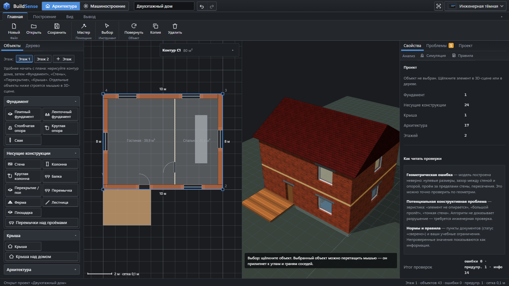

Это **учебный прототип**: не замена CAD/BIM-системам (FreeCAD, AutoCAD и т. п.) и не инженерный расчёт. Проверки
конструкции — эвристики («потенциальная проблема», «требуется инженерная проверка»), симуляция — кинематика
и демонстрация заданного сценария, а не физика, нормы — только сверенные пункты документов, остальное помечено.

## Скриншоты

### Архитектура

| План и 3D рядом | Только 2D-план |
|---|---|
|  | 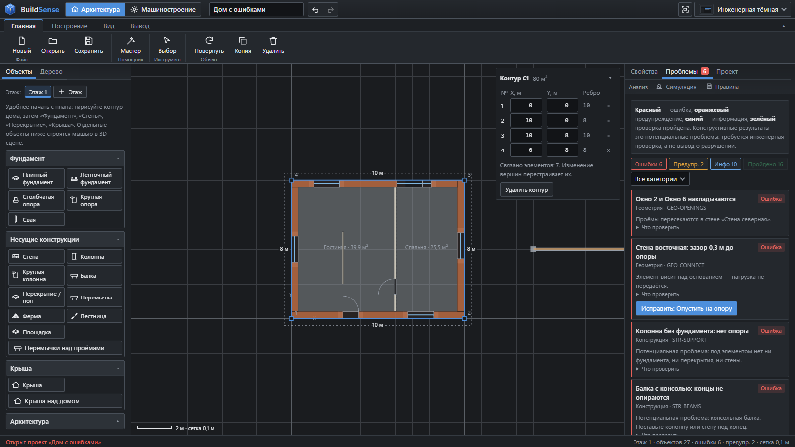 |
| **Мастер: фундамент → стены → перекрытие → крыша** | **Г-образный дом, вид 3D** |
|  | 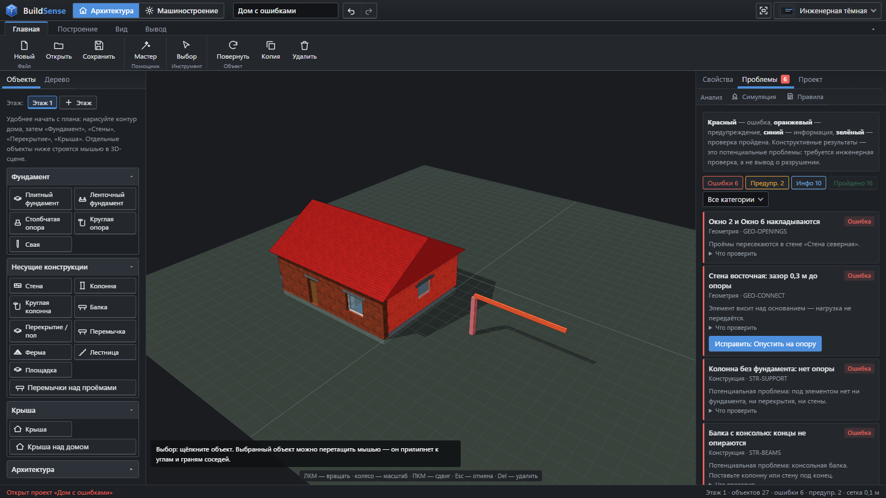 |
| **Проверки: ошибки и «Исправить»** | **Демонстрационная симуляция: отказ опоры** |
| 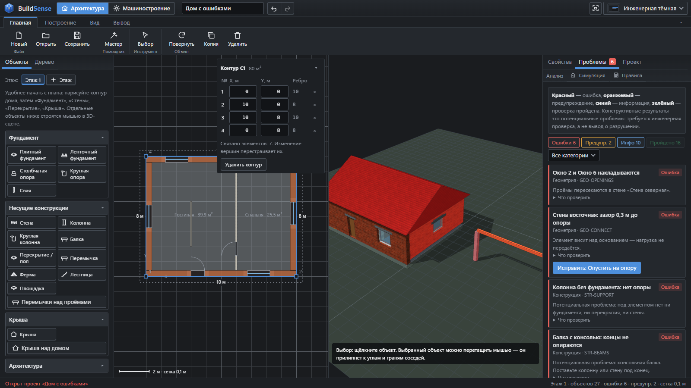 | 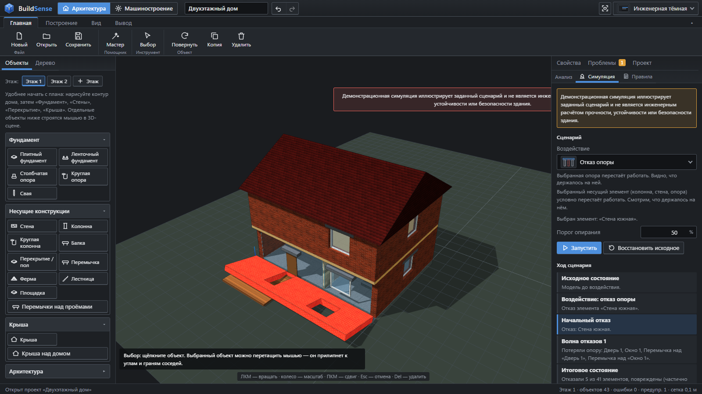 |

### Машиностроение

| Демонстрационные проекты | Учебные уроки |
|---|---|
| 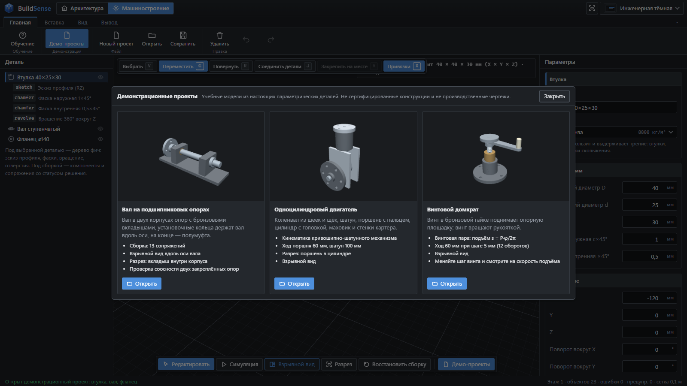 | 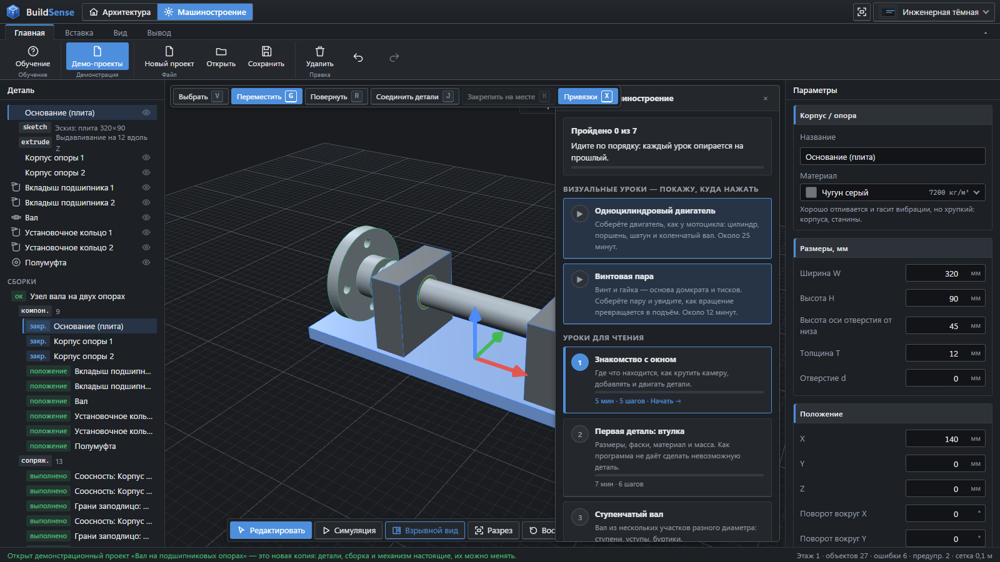 |
| **Двигатель: детали, сборка, сопряжения** | **Взрывной вид вала на опорах** |
| 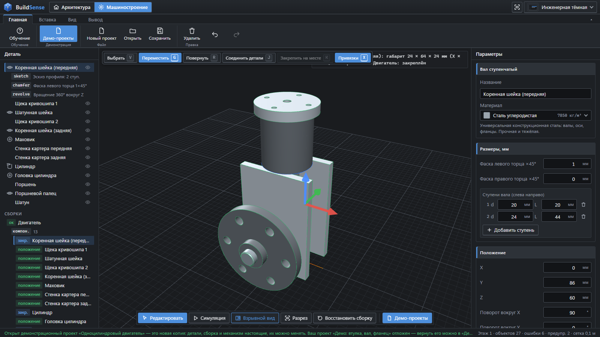 | 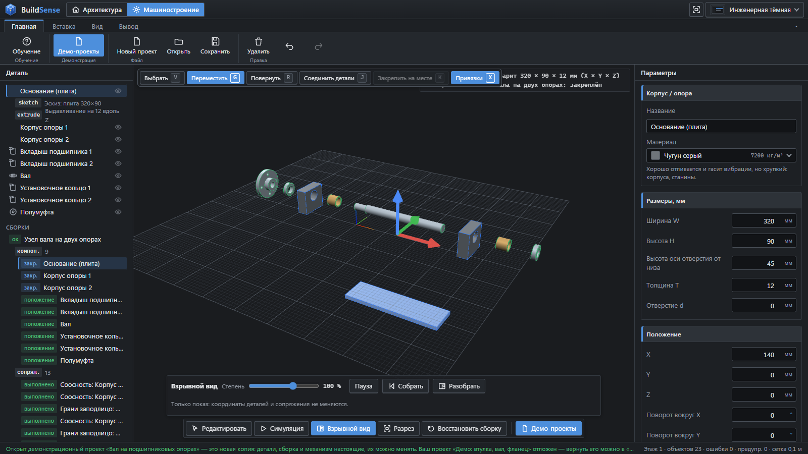 |
| **Симуляция: кривошипно-шатунный механизм** | **Разрез двигателя** |
| 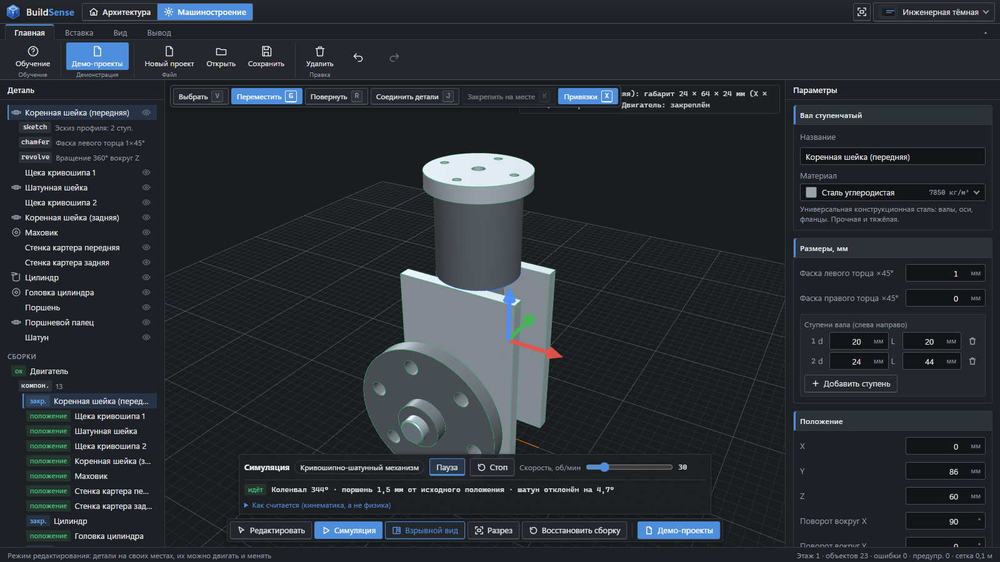 | 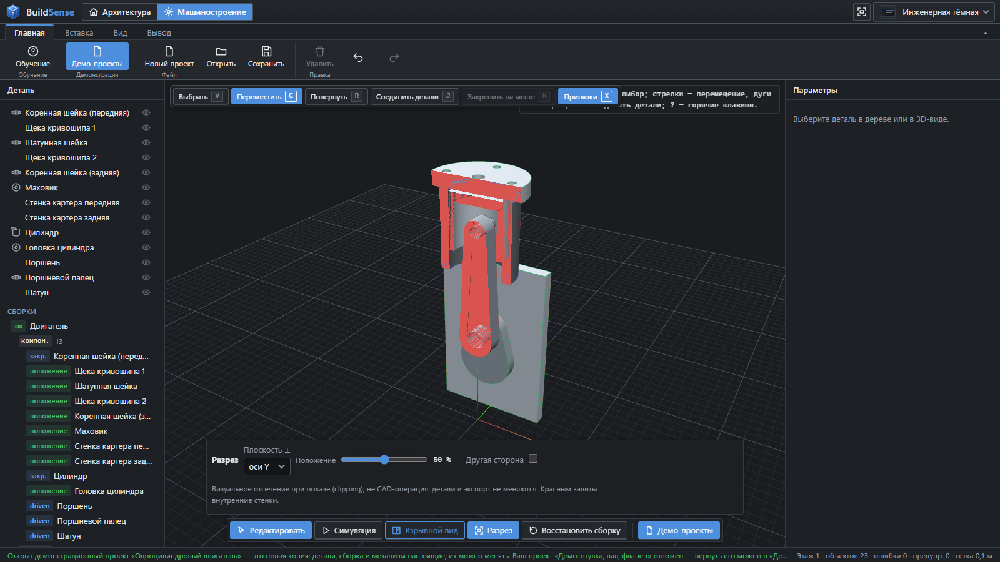 |
| **Домкрат: взрывной вид** | **Домкрат: подъём по s = P·φ/2π** |
| 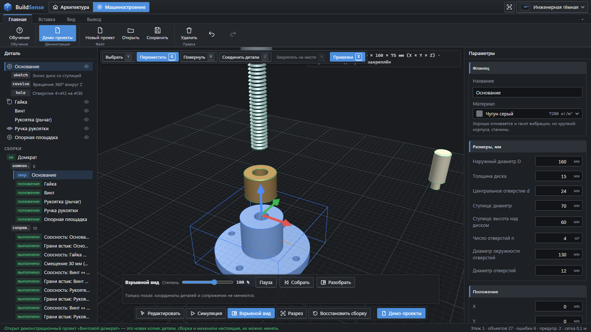 | 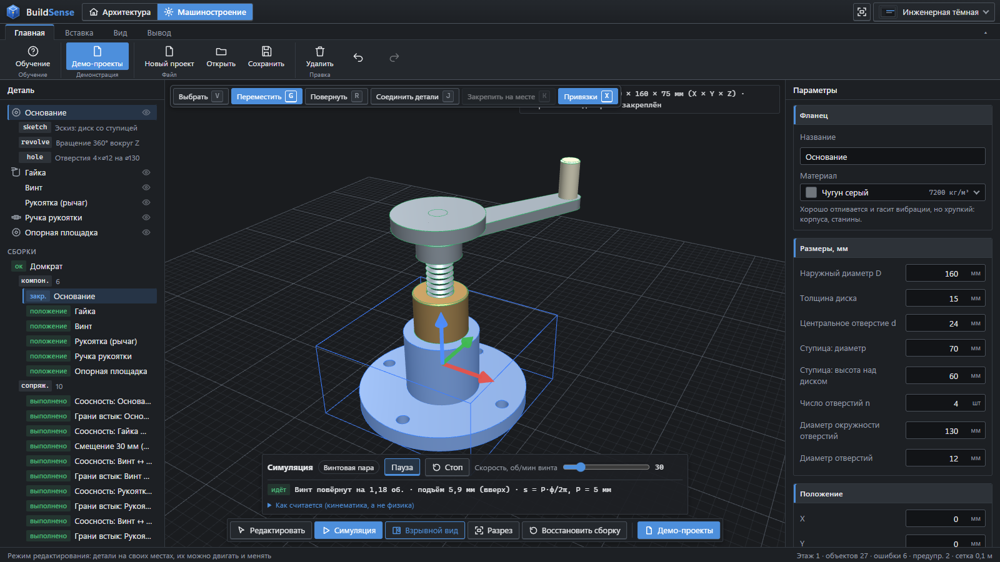 |
| **Разрез вала на опорах** | **Импорт во FreeCAD 1.1.4** |
| 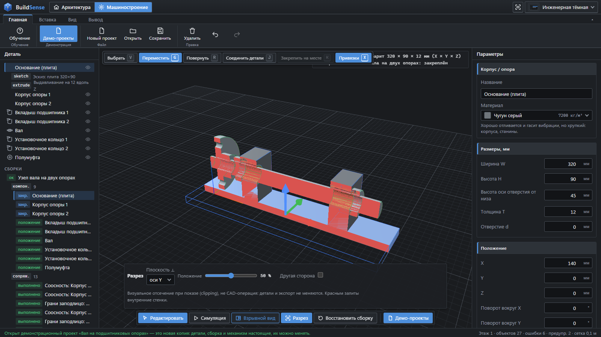 | 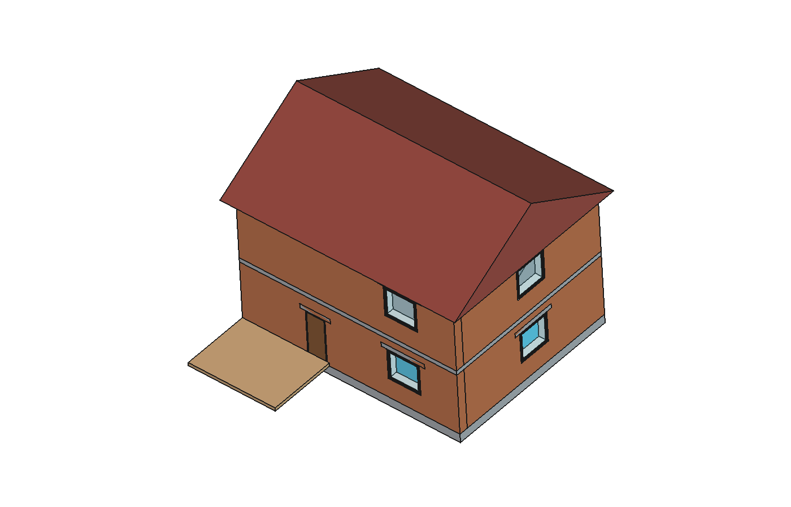 |

Скриншоты сняты в самой программе (Chrome, тёмная тема); разрез, взрывной вид и симуляция — только показ, проект они не меняют.

## Быстрый старт

1. Откройте `index.html` двойным щелчком (или `start.bat`; на Linux — `sh start.sh`). Интернет не нужен.
2. Проект уже открыт: двухэтажный дом, вид «План + 3D». Выберите стену — справа её свойства и проверки.
3. Вверху нажмите **«Машиностроение» → «Демо-проекты»** — выберите двигатель или домкрат.
4. Внизу 3D-окна: **«Симуляция» → «Пуск»**, **«Взрывной вид» → «Разобрать»**, **«Разрез»**,
   **«Восстановить сборку»** — вернуть всё как было.

## Туториал

Короткий путь по программе. Подробные руководства — [TUTORIAL.md](TUTORIAL.md) (дом и детали) и
[TUTORIAL_ASSEMBLY.md](TUTORIAL_ASSEMBLY.md) (как собрать детали в сборку, если вы «не механик»).

**Дом (архитектура)**

1. «Новый» → «Пустой проект». На **2D-плане** задайте контур дома — он сразу появится в 3D.
2. Нажмите «Мастер» и идите по шагам: **фундамент** по контуру → **стены** → **перекрытие** (пол, «+ Этаж») →
   **окна и двери** → **крыша**. Шаг отмечается зелёным, когда выполнен.
3. Вкладка **«Проблемы»**: щёлкните сообщение — элемент подсветится; кнопка «Исправить» убирает причину ошибки.
4. «Анализ → Симуляция» → «Отказ опоры» → «Запустить» — наглядный сценарий, не расчёт.
5. «Сохранить» (`*.buildsense.json`), затем «Экспорт в FreeCAD».

**Детали и сборки (машиностроение)**

1. Режим «Машиностроение» → «Вставка»: втулка, вал, фланец и другие детали. Размеры меняются справа в мм.
2. Кнопка **«Соединить детали»**: щёлкните две детали — программа сама поставит их соосно или встык
   (сопряжения решаются автоматически, статус виден в разделе «Сборки»).
3. **«Демо-проекты»**: вал на опорах, одноцилиндровый двигатель, винтовой домкрат. Открываются как новая копия;
   ваш проект откладывается и возвращается кнопкой «Вернуть мой проект».
4. **«Симуляция»**: пуск, пауза, скорость, текущий угол; для двигателя ход поршня считается по формуле
   x(θ) = r·cos θ + √(l² − (e − r·sin θ)²), для домкрата — s = P·φ/2π. Если цепь невозможна, будет сообщение об ошибке.
5. **«Взрывной вид»**: степень 0–150 %, «Собрать» / «Разобрать». **«Разрез»**: плоскость ⟂ X/Y/Z и положение.
   Всё это только показ — в сохранение и экспорт не попадает.
6. «Вывод» — экспорт для FreeCAD (`import_parts.FCMacro`), STL, чертёж PNG.

Подробные отчёты: [BUILDSENSE_SHOWCASE_REPORT.md](BUILDSENSE_SHOWCASE_REPORT.md) (взрыв, симуляция, демо),
[ASSEMBLY_QA_REPORT.md](ASSEMBLY_QA_REPORT.md) (проверка сборок), [BUILDSENSE_INTERACTION_REPORT.md](BUILDSENSE_INTERACTION_REPORT.md).

## Запуск

**Ничего устанавливать не нужно**: ни сервера, ни Python, ни интернета.

- Windows: двойной щелчок по `index.html` (или `start.bat`).
- Linux / RedOS: откройте `index.html` в Firefox, Chromium или Яндекс.Браузере (или `sh start.sh`).

Нужен браузер с WebGL. Библиотека Three.js r147 лежит локально в `vendor/three/` (лицензия MIT).
Запуск по `file://` проверен в Microsoft Edge (Chromium) на Windows 11 — см. [docs/TESTS.md](docs/TESTS.md);
Linux и Firefox пока не проверялись.

Последний проект, режим и вид сохраняются в браузере (localStorage). Файлы проекта дома — `*.buildsense.json`.

## Экран

| Место | Что там |
|-------|---------|
| Верхняя строка | название программы, переключатель «Архитектура / Машиностроение», название проекта, команды файла, «Чистый просмотр», тема |
| Панель команд | в архитектуре — вид «План / 3D / План + 3D» и команды плана; в машиностроении — команды детали; по краям — свернуть левую / правую панель |
| Слева | архитектура: «Объекты» (этажи и палитра) и «Дерево»; машиностроение — дерево детали |
| Справа | архитектура: «Свойства», «Проблемы», «Проект», ниже — группа «Анализ» («Симуляция», «Правила»); машиностроение — параметры детали |
| Снизу | строка состояния: результат последнего действия и сводка проекта |

«Чистый просмотр» скрывает боковые панели и оставляет всю ширину окна под модель (повторное нажатие или **Esc** — вернуть).

## Сценарий демонстрации (10 минут)

Порядок — как в разделе «Туториал» выше: дом (шаги 1–5), затем демо-проекты машиностроения.

Ссылки для демонстрации: `index.html#example=twoStorey`, `#example=issues`, `#example=starter`
(дополнительно `&wizard=0`, `&view=top`, `&tab=problems`, `&archview=plan`, `&archview=3d`, `&mode=mech`).

## Возможности (архитектура)

| Область | Что работает |
|---------|--------------|
| 2D-план | контур и стены в плане, синхронно с 3D |
| Объекты | фундаменты: плита, лента, столбчатая и круглая опоры, сваи; стены (наружные, внутренние, перегородки), колонны, балки, перекрытия, перемычки, фермы, лестницы, площадки; крыши: плоская, односкатная, двускатная, вальмовая; окна и двери с проёмами; балкон, терраса, перила, дымоход, комнаты-зоны, карниз. Инженерные системы и мебель в сценарий не входят и скрыты; старые проекты с ними открываются |
| Построение | палитра + мышь: по двум точкам (цепочкой), прямоугольником, щелчком в точку (R — поворот), щелчком по стене; привязки к углам, граням, осям, сетке (5 см – 1 м); элементы садятся на фундамент/перекрытие; стены стыкуются встык |
| Редактирование | выбор щелчком и в дереве (Ctrl — несколько), перетаскивание, X/Y/Z с шагом сетки, поворот, размеры в свойствах, дублирование (Ctrl+D), копирование на этаж, удаление (Del), отмена/повтор (Ctrl+Z / Ctrl+Y, 100 шагов) |
| Этажи | несколько этажей; «+ Этаж» — перекрытие по наружным стенам и копия стен с окнами |
| Вид | «План / 3D / План + 3D»; в 3D — перспектива / ортография, вид сверху, фасад, изометрия, «вписать», изоляция (I), скрытие категорий, габариты; «Чистый просмотр»; тёмная и светлая тема |
| Проверки | геометрия, конструкция, нормы — автоматически после каждого изменения; цвета, фильтры, переход к элементу, кнопки «Исправить» ([docs/CHECKS.md](docs/CHECKS.md)) |
| Анализ | симуляция: 5 детерминированных сценариев ([docs/SIMULATION.md](docs/SIMULATION.md)); реестр правил в `data/rules/`, учебные правила через форму или импорт JSON |
| Расчёты | объём, масса, собственный вес, нагрузка, проверка балки по формулам сопромата с допущениями — учебные, не проектные |
| Мастер | шаги: фундамент → стены → этажи и перекрытия → окна и двери → крыша → проверка → симуляция → экспорт |
| Файлы | проект JSON (схема 2, миграция прежнего формата), экспорт JSON для FreeCAD в мм ([docs/JSON_FORMAT.md](docs/JSON_FORMAT.md)) |
| FreeCAD | макрос: BIM-объекты Arch (Wall, Window, Structure, Stairs, Space, этажи) и примитивы Part; отчёт о неподдерживаемом; сохранение `.FCStd` |

## FreeCAD

1. В BuildSense: «Экспорт в FreeCAD» → `<имя>.freecad.json`; рядом кнопка «Скачать макрос» → `import_house.FCMacro`
   (тот же файл, что `freecad/import_house.FCMacro`; встроен в `js/io/macroSource.js`, после правки макроса — `node tools/build-macro.js`).
2. Во FreeCAD: **Макрос → Макросы…** → папка со скачанным макросом → `import_house` → **Выполнить** → выбрать файл → сохранить `.FCStd`.

Режим BIM (по умолчанию): стены — Arch Wall, окна и двери — Arch Window с вырезом в стене, фундаменты, плиты,
колонны, балки, перемычки — Arch Structure с IFC-типом, лестницы — Arch Stairs, комнаты — Arch Space, этажи — BuildingPart.
Крыши, фермы, перила — параметрические примитивы Part (не BIM-объекты).
Если BIM-объект создать не удалось, элемент строится примитивом Part, причина — в отчёте импорта.
Переменная `BUILDSENSE_MODE=part` — только примитивы Part.

**Проверено на FreeCAD 1.1.4 (Windows x64)** — консольный и графический режимы, BIM и Part, габариты всех
объектов сверены с JSON (см. [docs/TESTS.md](docs/TESTS.md)). Другие версии FreeCAD не проверялись.
Импорт деталей машиностроения — см. [docs/MECH.md](docs/MECH.md).

## Структура

```
index.html, css/app.css         оболочка интерфейса и тема; css/plan.css, css/mech.css — стили режимов
vendor/three/                   Three.js r147 + OrbitControls (локально)
js/core/                        пространство имён BuildSense, геометрия плана
js/materials/                   материалы (плотность, модуль упругости, учебное [σ])
js/objects/                     реестр типов, формы, опирание, привязки, модель проекта и команды
js/editor/                      инструменты мыши, история отмены
js/scene/                       3D-сцена, построение геометрии, габариты
js/plan/                        2D-план
js/validation/                  параметры модели, движок проверок
js/rules/                       реестр правил, проверка норм, встроенные правила
js/simulation/                  граф опирания, сценарии, показ в 3D
js/calculations/                упрощённые расчёты
js/io/                          проект JSON, экспорт для FreeCAD
js/mech/                        машиностроение: модель, геометрия и файлы деталей, интерфейс режима
js/ui/                          оболочка (shell.js: режимы, вид, панели, строка состояния), палитра, дерево, свойства,
                                проблемы, симуляция, правила, проект, мастер
js/app.js                       контроллер архитектуры: edit() → снимок для отмены → изменение → проверки → перерисовка
data/rules/                     правила (источник истины), docs/ — документация (docs/INTEGRATION.md — контракт модулей)
examples/                       демонстрационные проекты и экспорт; examples.js — для меню «Новый»
freecad/                        макросы импорта
tests/                          автотесты Node.js и Python, тест в настоящем FreeCAD
tools/                          генераторы встроенных правил и примеров
```

Все модули — обычные скрипты в общем пространстве имён `BuildSense` (так работает `file://`). Модули без DOM
(`core`, `materials`, `objects`, `rules`, `validation`, `simulation`, `calculations`, `io`, `editor/history`)
загружаются в Node.js для тестов (`tests/loader.js`). Если какой-то модуль режима не загрузился, оболочка
показывает на его месте сообщение, остальная программа работает.

**Интерфейсы ключевых модулей:**

| Модуль | Функции |
|--------|---------|
| `BuildSense.shell` | `setMode("arch" \| "mech")`, `setArchView("plan" \| "3d" \| "split")`, `setCleanView(on)`, `togglePanel("left" \| "right")`; события `mode`, `archview`, `layout`, `status` |
| `BuildSense.project` | `createProject`, `createStarterProject`, `addElement`, `updateElement`, `removeElements`, `addWallByPoints`, `addSegment`, `addRect`, `placeAt`, `placeOpening`, `moveElement`, `rotateElement`, `duplicate`, `addLevel`, `addLintels`, `addRoofOverBuilding`, `wallsAroundFoundation`, `slabInsideWalls`, `autoOpenings` |
| `BuildSense.validation` | `validate(project) → { issues, summary, norms, ruleErrors }`, `severityByElement`, `applyFix` |
| `BuildSense.ruleRegistry` | `builtin`, `all(project)`, `makeUserRule`, `importRules` |
| `BuildSense.checker` | `checkModel(parameters, rules)`, `validateRule`, `compare`, `convertValue` |
| `BuildSense.simulation` | `run(project, scenario, options) → { steps, failed, damaged, report, assumptions }` |
| `BuildSense.calculations` | `forElement(project, element, options)`, `beamCheck` |
| `BuildSense.projectIO` | `serialize`, `parse`, `fromData`, `migrateV1`, `download`, `readFile`, `autosave` |
| `BuildSense.freecadExport` | `build(project) → { data, warnings }` |

## Тесты

```bash
node --test "tests/*.test.js"
```

```bash
python tests/test_macro_mock.py
```

```bash
"<папка FreeCAD>/bin/freecadcmd.exe" tests/freecad_real_test.py
```

Результаты и ручные проверки — [docs/TESTS.md](docs/TESTS.md). После правки `data/rules/*.json` — `node tools/build-rules.js`,
после изменения логики примеров — `node tools/make-examples.js`.

## Ограничения и развитие

**Ограничения.**
- **Конструктивных расчётов нет.** Проверки — эвристики, симуляция — демонстрация по правилам опирания, «Расчёт» —
  упрощённые формулы с явными допущениями. Решения о прочности принимает инженер.
- **Это не CAD-ядро.** Модель показывается сеткой треугольников (Three.js); детали машиностроения — параметрические
  тела, а не B-rep: нет булевых операций с допусками, сопряжений, чертежей по ЕСКД. Сетка для Blender годится для
  визуализации, а не для производства; точную модель даёт FreeCAD после импорта.
- Стены только прямые; проёмы прямоугольные; крыша — один объём над прямоугольником; помещения — условные зоны;
  нет манипуляторов трансформации в 3D (перемещение мышью и числами).
- Проверено в Edge/Chromium на Windows и в FreeCAD 1.1.4; Firefox и Linux не проверялись.

**План развития.**
1. Манипуляторы перемещения и поворота в 3D, выделение рамкой.
2. Стены по полилинии с автоматическими углами, наклонные и криволинейные стены.
3. Помещения, вычисляемые из контура стен; площади и нормы по комнатам.
4. Крыши по произвольному контуру (Arch Roof), мансарды.
5. Нагрузки по этажам и расчётная схема, проверка по сверенным нормам.
6. Экспорт IFC через FreeCAD, импорт обратно в BuildSense.
7. Расширение реестра сверенных правил (только после сверки по тексту действующей редакции).
8. Проверка в Firefox и на RedOS, сенсорное управление.
